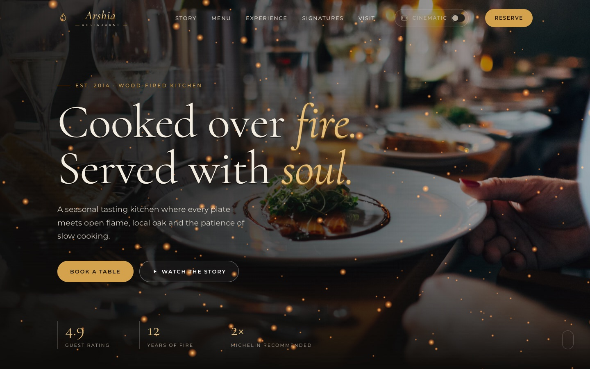

# Arshia Restaurant

A cinematic, 3D-styled website for a fictional fine-dining restaurant, built with plain HTML, CSS and JavaScript, plus Three.js for the 3D effects.

**[Live Demo](https://arshaduzzaman3620.github.io/arshia-restaurant/)**




## Features

- **3D hero scene**: glowing embers rendered in WebGL with Three.js, with a mouse-driven parallax camera
- **3D dish carousel**: a rotating ring of signature dishes, controlled by arrows, keyboard, drag or swipe
- **Cinematic intro**: an animated title reveal with opening curtains
- **Scroll-driven story**: three full-screen chapters that change as you scroll, with a progress bar
- **Cinematic mode**: a toggle that adds letterbox bars, film grain and a colour grade, and remembers your choice
- **3D tilt cards**: cards tilt toward the cursor with a soft light glare
- **Interactive menu**: accessible tabs for starters, mains, desserts and drinks
- **Reservation form**: inline validation, a loading state and a confirmation message
- **Fully responsive**: tested at phone, tablet and desktop sizes

## Tech Stack

| Area | Tools |
|------|-------|
| Markup | HTML5 (semantic sections, ARIA roles) |
| Styling | CSS3 (custom properties, Grid, Flexbox, 3D transforms, keyframes) |
| Scripting | Vanilla JavaScript (ES6+), Intersection Observer API |
| 3D | [Three.js](https://threejs.org/) r128 |
| Fonts | Cormorant and Montserrat (Google Fonts) |

There is no framework and no build step.

## Accessibility and Performance

- Keyboard navigation for the menu tabs, carousel and mobile menu, with visible focus states
- Respects `prefers-reduced-motion`: heavy animations and the intro are turned off
- Form errors are announced to screen readers and linked to their fields
- Images below the fold are lazy-loaded
- The 3D scene pauses when it's off-screen or the tab is hidden

## Run Locally

Open `index.html` in a browser, or serve the folder:

```bash
npx http-server .
```

Then visit `http://localhost:8080`.

## Project Structure

```
arshia-restaurant/
├── index.html    # Page structure and content
├── styles.css    # Design tokens, layout, 3D and cinematic styles
├── script.js     # Interactions, Three.js scene, carousel, form logic
└── assets/       # README screenshot
```

## Notes

- Arshia Restaurant is a fictional business made for this portfolio project. The address, phone number, reviews and email addresses are placeholders.
- The reservation form is front-end only and does not send data anywhere.
- Food and interior photos are from [Unsplash](https://unsplash.com) and are free to use under the Unsplash License.
